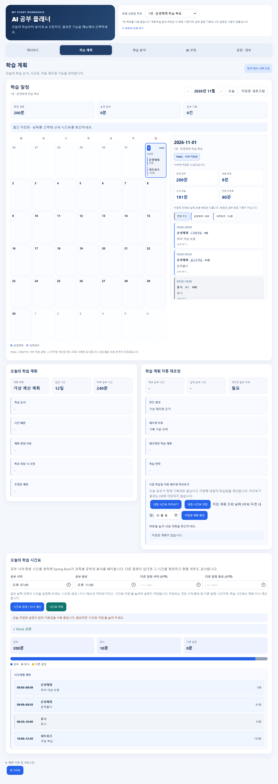
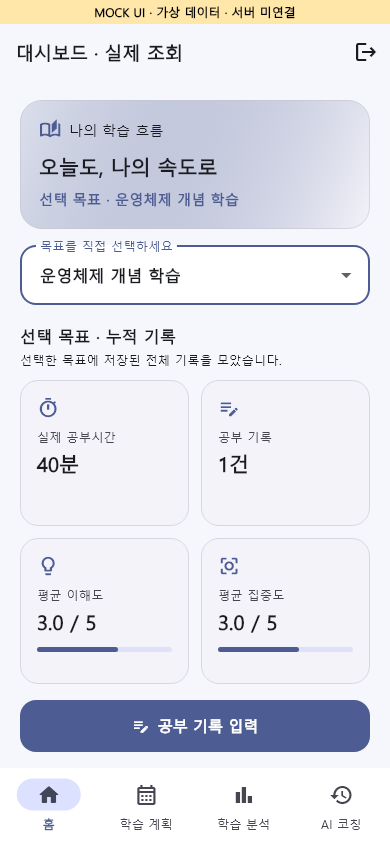
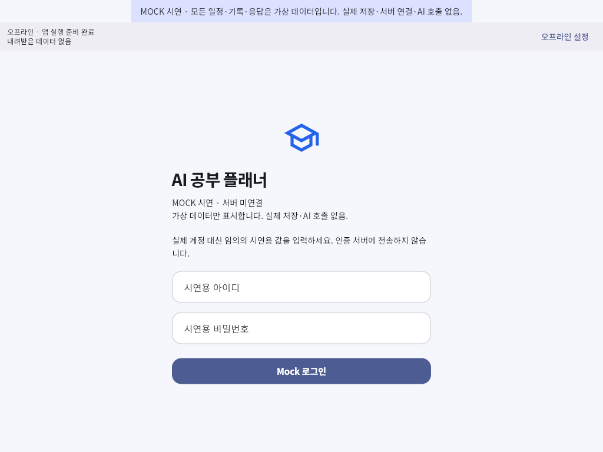
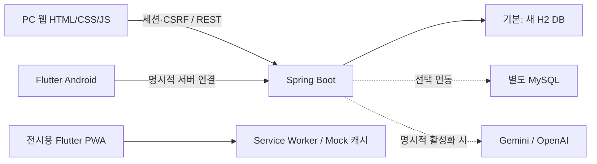

# AI 공부 플래너

학습 목표와 실제 공부 기록을 연결해 계획을 세우고, 진행 상황을 분석하며, 필요할 때 AI 학습 조언을 받는 개인 학습 관리 프로젝트입니다.

**개발 기간: 2026.03 ~ 2026.11.10**  
업로드 대상: [cafrijo-ux/ai-study-planner](https://github.com/cafrijo-ux/ai-study-planner)

이 폴더는 취업 포트폴리오를 위해 원본에서 별도로 구성한 소스 배포본입니다. 개인 계정·학습 기록·기존 DB·API 키·이전 Git 이력은 포함하지 않습니다. 기본 실행은 **새 로컬 H2 DB**, **사용자가 직접 설정한 계정**, **AI 호출 비활성화** 상태입니다.

## 저장소 접근 권한

| 공개 범위 | 소스 조회·다운로드·clone | 변경 업로드 |
| --- | --- | --- |
| Private | 소유자와 읽기 권한을 받은 사용자만 접근할 수 있으며 GitHub 인증이 필요합니다. 링크만 공유해도 접근 권한이 생기지는 않습니다. | 별도의 쓰기 권한이 필요합니다. |
| Public | 누구나 소스를 조회·다운로드·clone할 수 있습니다. | Public이어도 다른 사용자가 바로 push할 수 있는 것은 아니며 별도의 쓰기 권한이 필요합니다. |

현재 저장소는 **Private**입니다. 소유자가 접근 권한을 제공하거나 공개 범위를 변경해야 다른 사용자도 그 범위에 맞게 접근할 수 있습니다. 저장소 공개 범위와 앱의 로컬 로그인은 별개이며, 실행한 사용자는 아래 절차로 자신의 로컬 계정을 만듭니다.

## 주요 기능

- 목표와 필수 과목의 통합 등록, 목표별 과목·기록 분리
- 공부 시간·이해도·집중도·피로도·문제 풀이 결과 기록 및 조회
- 실제 기록을 바탕으로 한 학습 현황·취약 과목·진행률 분석
- 학습 시간표 생성, 재조정 미리보기, 저장 계획 달력과 FINAL/DRAFT 구분
- Gemini 학습 코칭·기록 요약·질문 답변과 OpenAI 주간 코칭·질문 답변 연동 소스
- AI 응답 이력, 실패 시 기본 조언, 요청 중복·비용 제어를 위한 선택 기능과 자동화 테스트
- 세션 로그인, BCrypt 비밀번호 해시, CSRF, 단일 데모 사용자 소유권 검증

현재 인증 구조는 로그인 소유자 한 명을 `user_id=1`에 연결하는 개인용 데모입니다. 다중 사용자 서비스와 운영 서버 배포는 별도 설계가 필요합니다. H2 기본 실행에서는 확장 원장 기능을 끄고 일반 공부 기록·계획 기능을 사용합니다.

## 화면

모두 이번 검증에서 **합성 Mock 데이터로 생성한 화면**입니다. 실제 학습 기록이나 실제 AI 응답이 아닙니다.

| PC 웹: 계획·달력 | Flutter Android: 대시보드 |
| --- | --- |
|  |  |



## 기술 스택과 구조

| 영역 | 구성 |
| --- | --- |
| 서버 | Java 17, Spring Boot 4.0.6, Gradle Wrapper 9.5.1 |
| 데이터·인증 | Spring Data JPA, JDBC, Spring Security, BCrypt, 세션·CSRF |
| DB | 기본 H2 파일 DB / 기존 MySQL 연동 소스와 Connector/J |
| PC 웹 | HTML, CSS, JavaScript, Spring 정적 리소스·동일 origin API |
| 모바일 | Flutter 3.47.8·Dart 3.13.7에서 검증, Android 네이티브 저장·통신 설정 |
| 전시 PWA | 별도 Flutter Web 소스, Service Worker, 로컬 Mock 스냅샷, 내장 한국어 폰트 |
| 검증 | JUnit, Spring MockMvc, H2, Mockito, Flutter test, Playwright, Node test |



```text
src/main/java/          서버 도메인·API·인증·공개본 안전 기본값
src/main/resources/     PC 웹, H2 초기 스키마, 공개본 설정
src/test/               JUnit·H2·Mock·브라우저 테스트와 합성 fixture
mobile_flutter/         현재 Flutter Android 앱 소스·테스트
android/                별도 Java Android 브라우저/TWA 연결 셸
offline-pwa/            전시용 PWA의 분리된 Flutter 소스·빌드 도구·테스트
scripts/                최초 계정 설정·로컬 실행
config/                 MySQL 환경변수 설정 예시
docs/                   구조·검증·보안·공개 파일 목록·스크린샷
```

PWA는 브라우저용 조건부 import와 오프라인 기능을 보존한 전시용 소스 스냅샷입니다. 현재 `mobile_flutter/`의 Android 중심 구현과 별도로 빌드합니다. PWA에 사전 빌드된 JavaScript·WASM이나 캐시는 포함하지 않습니다.

## Windows 설치와 PC 웹 실행

필수: **Windows 10/11, JDK 17(java·javac), PowerShell 7 권장(Windows PowerShell 5.1 사용 가능)**. 소스를 받은 폴더에 쓰기 권한이 필요합니다. 첫 빌드에는 Gradle 배포본·Maven 의존성을 내려받을 인터넷이 필요하며, 전역 Gradle·MySQL·Node.js는 PC 웹 기본 실행에 필요하지 않습니다.

1. GitHub의 Code → Download ZIP으로 내려받아 압축을 풀거나 저장소를 clone합니다. PowerShell에서 `gradlew.bat`가 있는 폴더로 이동합니다.
2. Java 버전을 확인하고 실행 JAR을 빌드합니다.

   ```powershell
   java -version
   javac -version
   .\gradlew.bat --no-daemon bootJar
   ```

3. **새 로컬 계정**을 설정합니다. 이름은 영문·숫자·`-`·`_` 3~40자, 비밀번호는 12자 이상입니다. 비밀번호 입력은 화면에 표시되지 않으며 BCrypt 해시만 `.local/auth.properties`에 저장합니다.

   ```powershell
   .\scripts\Initialize-Local.ps1
   ```

4. 프로젝트 루트에서 아래 두 방식 중 하나로 서버를 실행합니다.

   **기본 포트 8083:**

   ```powershell
   .\scripts\Start-Local.ps1
   ```

   접속 URL: [http://127.0.0.1:8083/login.html](http://127.0.0.1:8083/login.html)

   **별도 포트 18087:**

   ```powershell
   .\scripts\Start-Local.ps1 -Port 18087
   ```

   접속 URL: [http://127.0.0.1:18087/login.html](http://127.0.0.1:18087/login.html)

실행 정책 때문에 스크립트가 차단되면 해당 스크립트 내용과 조직 정책을 확인하고, 허용된 환경에서 현재 PowerShell 세션 범위의 실행 정책을 조정하세요. 시스템 전체 실행 정책 변경은 필요하지 않습니다.

최초 실행은 이 배포 폴더의 `.local/data/planner-public.mv.db`를 생성하고 개인 정보가 없는 데모 소유자 행만 준비합니다. 목표·과목·공부 기록은 비어 있으므로 로그인 후 목표와 과목부터 등록하세요. 재시작 시 기존 H2 데이터를 보존하며 DROP·DELETE·create-drop 초기화를 수행하지 않습니다. `.local/`을 삭제하면 새 공개본에서 작성한 기록도 사라지므로 보관하세요. 원본 프로젝트의 DB를 복사하거나 해당 DB 경로를 지정할 필요가 없습니다.

선택한 포트가 이미 사용 중이면 실행 스크립트가 중단되며 기존 프로세스를 종료하지 않습니다. 서버에 접속할 때는 실행 명령에 지정한 포트를 URL에도 사용하세요. 같은 폴더의 H2 파일로 서버 여러 개를 동시에 실행하지 마세요. 기존 서버와 별도로 실행하려면 새 clone이나 별도 사본에서 다른 포트를 사용합니다. 종료는 새로 실행한 서버 터미널에서 Ctrl+C를 사용합니다.

## API 키 없이 사용하는 기능

목표·과목 등록, 공부 기록 저장·조회, 계획·시간표·달력, 기록 기반 분석과 규칙 기반 조언은 API 키 없이 동작합니다. 공개본의 AI 생성 경로는 기본적으로 HTTP 503과 비활성화 안내를 반환하며 외부 제공자에 요청하지 않습니다. 기본 학습 관리 화면에서 AI 버튼을 눌러도 결제되는 요청을 보내지 않습니다.

## 선택: AI API 키 설정

`.env.example`은 설정 항목 참고용이며 Spring Boot가 `.env` 파일을 자동으로 읽지는 않습니다. 실제 키는 **로컬 PowerShell 환경변수**로 설정하세요. `.local/`과 비밀 설정을 Git에 추가하지 마세요. 모델의 제공 여부·권한·요금은 사용자가 자신의 계정에서 확인해야 하며 이번 준비 작업에서는 실제 제공자 호출을 수행하지 않았습니다.

기본값은 다음과 같습니다.

| 환경변수 | 기본값 | 의미 |
| --- | --- | --- |
| `PLANNER_AI_ENABLED` | `false` | AI 생성 경로 전체 허용 여부 |
| `PLANNER_AI_DEMO_MODE` | `true` | 일반 코칭의 데모 모드 |
| `GEMINI_API_KEY` | 미설정 | Gemini 키 |
| `OPENAI_API_KEY` | 미설정 | OpenAI 키 |
| `PLANNER_GPT_ENABLED` | `false` | OpenAI 주간 코칭 |
| `PLANNER_GEMINI_QUESTION_ENABLED` | `false` | Gemini 질문 답변 |
| `PLANNER_GPT_QUESTION_ENABLED` | `false` | OpenAI 질문 답변 |

키는 `Read-Host -AsSecureString` 등 화면·명령 이력에 남기지 않는 방법으로 입력해 프로세스 환경에 전달하세요. 전체 AI를 활성화하려면 `PLANNER_AI_ENABLED=true`를 명시해야 하며, 일반 코칭에는 `PLANNER_AI_DEMO_MODE=false`, 질문·주간 코칭에는 해당 기능 플래그도 필요합니다. 활성화 후 사용자의 버튼 동작에 따라 학습 맥락이 제공자에 전송되고 요금이 발생할 수 있습니다. 사용 후 환경변수를 해제하고 서버를 재시작하면 비활성화 기본값으로 돌아갑니다.

`GeminiStudySummaryController`, `LlmCoachingController`, `StudyQuestionController`, `GptWeeklyCoachingController`에 기존 모델·요청 소스가 보존되어 있습니다. 실제 연결과 유료 사용 검증은 미수행입니다.

## Android와 오프라인 PWA

| 실행 형태 | 서버·저장 | 실행 방법·제약 |
| --- | --- | --- |
| PC 웹 | 로컬 Spring + 새 H2, 실제 CRUD | 기본 `127.0.0.1:8083` |
| Flutter Android (`mobile_flutter`) | 기본은 Mock. `API_BASE_URL`을 명시하면 서버 연결 | Flutter·Android SDK·디바이스 필요. 기본 Mock 모드로 먼저 확인 |
| Java Android 셸 (`android`) | 승인된 HTTPS 웹 origin을 여는 별도 앱 | 기본 origin은 비어 있음. 로컬 8083을 자동 연결하지 않음 |
| 전시용 PWA (`offline-pwa`) | Mock 전용, 앱 셸·합성 스냅샷 캐시 | PC 웹 DB·계정과 동기화하지 않음. 최초 온라인 준비 후 오프라인 실행 |

Flutter Android:

```powershell
cd mobile_flutter
flutter pub get
flutter test
flutter run
# APK 파일이 필요한 경우
flutter build apk --debug
```

실서버 연결은 기존 앱의 주소·포트·cleartext·USB/Wi-Fi 검증 정책을 따릅니다. 원본 운영 서버나 개인 DB를 연결하지 마세요. 기본 Mock은 임의의 시연용 값을 사용하며 실제 인증 서버로 전송하지 않습니다. 실기기 설치·연결 및 APK 빌드는 이번 배포 준비에서 별도 검증하지 않았습니다.

전시용 PWA는 Node.js 22 이상과 Flutter SDK도 필요합니다.

```powershell
cd offline-pwa
.\tools\build-pwa.ps1
node tools/preview-pwa.cjs 59261
```

[http://127.0.0.1:59261/ipad/](http://127.0.0.1:59261/ipad/)에서 앱 실행 준비 완료를 확인한 뒤 네트워크를 끄고 새로고침할 수 있습니다. `file://`로 열면 Service Worker를 사용할 수 없습니다. 미리보기는 루프백 전용이며 기본 45분 후 종료됩니다. 브라우저 캐시는 공개본 DB와 별개입니다.

## 테스트

```powershell
.\gradlew.bat --no-daemon test connectorTest bootJar
cd mobile_flutter
flutter pub get
flutter test
cd ..\offline-pwa
flutter pub get
flutter test
cd ..
npm ci
# Edge가 없는 환경의 Chromium 테스트
npx playwright install chromium
$env:BROWSER_CHANNEL='chromium'
npm run test:web
npm run test:pwa
```

JUnit의 H2 테스트는 MySQL 드라이버를 런타임에서 제외하고, Connector/J 내부 Mock 테스트는 별도 `connectorTest`에서 실행합니다. 테스트별 JVM 격리는 기존 네트워크 가드의 영향을 다른 테스트와 분리합니다. 명시적 opt-in이 필요한 실제 HTTP 브라우저용 JUnit 검사는 기본 실행에서 건너뜁니다. 자동화 테스트에서 실제 AI·개인 DB 연결은 사용하지 않습니다.

### GitHub 새 clone 실행 검증

2026-11-14에 첫 배포 commit `9f95db3f6929e8cb004c0f66dbd058626119a7f7`을 원본·공개 준비 폴더 밖의 새 임시 폴더에 clone해 검증했습니다. JDK 17.0.20.1·Windows PowerShell 5.1, 공백이 있는 경로와 **빈 Gradle 캐시**에서 빌드가 성공했습니다(47초).

새 H2와 최초 계정을 만든 뒤 실제 웹 로그인, 목표·과목 등록, 시간표·계획 저장, 월간 달력, 공부 기록 저장·조회, 서버 재시작 후 데이터·계정 보존까지 **11개 검증 항목이 모두 통과**했습니다. API 키를 전달하지 않았고, 외부 통신 차단 계측에서도 실제 AI 접속은 0건이었습니다. 생성된 계정·DB·빌드 결과는 Git 대상에서 제외됐습니다.

이 검증은 JDK가 설치된 Windows에서 수행했습니다. 완전히 새 PC의 OS·JDK 설치부터 진행한 검증, Android APK 빌드·실기기, 실제 MySQL 연결, Gemini/OpenAI 유료 호출은 완료한 것으로 간주하지 않습니다. 첫 배포 commit의 GitHub Actions에서도 Java 테스트·JAR 빌드와 웹·PWA 검사가 성공했습니다. 현재 문구 수정본의 원격 Actions는 아직 실행하지 않았습니다.

상세 결과와 검증 범위는 [검증 보고서](docs/VALIDATION.ko.md), 보안 범위는 [보안 보고서](docs/SECURITY-REVIEW.ko.md), 전체 공개 파일은 [파일 목록](docs/PUBLIC-FILES.txt)을 확인하세요.

## 공개 범위와 원본 보존

원본 소스·설정·MySQL/H2 데이터·실행 환경은 보존합니다. 이 배포본에서만 H2 기본 설정, 계정 준비, 로컬 HTTP 쿠키 설정, AI 기본 차단, 재현 가능한 테스트 경로·의존성을 추가했습니다. 기존 Git 이력을 가져오지 않은 첫 배포 commit은 Private 저장소에 업로드됐습니다. 이번 문서·안내 문구 수정은 로컬 검토 상태이며, 추가 commit·push와 Public 전환은 별도 승인 이후의 작업입니다.

폰트 등 제3자 자산의 이용 조건은 [THIRD-PARTY-NOTICES.md](THIRD-PARTY-NOTICES.md)에 정리했습니다. 프로젝트 자체의 배포 라이선스는 소유자가 아직 지정하지 않았습니다.
